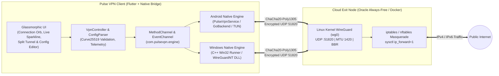

# Pulse VPN

**Pulse VPN** is a cross-platform WireGuard VPN client and zero-configuration server suite built for **Windows (x64)** and **Android (ARM64)**. It combines a Flutter dark-mode glassmorphic frontend with native platform tunnel engines (`VpnService` on Android and `WireGuardNT` Service IPC on Windows) and an automated Oracle Cloud Always-Free WireGuard server bootstrap.

---

## System Architecture



### Repository Layout

```text
pulse-vpn/
├── lib/
│   ├── main.dart                     # Application entry point & dark theme setup
│   ├── core/
│   │   ├── wg_config.dart            # WireGuard .conf parser, validator & serializer
│   │   ├── vpn_bridge.dart           # Platform MethodChannel / EventChannel bridge
│   │   └── vpn_controller.dart       # State management, telemetry & profile store
│   └── ui/
│       ├── home_screen.dart          # Main dashboard, connection orb & live metrics
│       └── widgets/                  # Throughput chart, config import modal & split-tunnel UI
├── android/                          # Android Kotlin VpnService & Gradle configuration
├── windows/                          # Windows C++ Win32 runner & WireGuardNT tunnel bridge
├── server/
│   ├── setup-server.sh               # Zero-config Oracle Cloud Always-Free bootstrap script
│   └── docker-compose.yml            # Containerized linuxserver/wireguard & wg-easy deployment
├── test/
│   └── test_core_engine.py           # Automated verification suite for configs, bridge & native targets
└── .github/workflows/
    └── build.yml                     # CI pipeline for tests, Android APK & Windows executable
```

---

## Quickstart

### 1. Provision Your WireGuard Server (Oracle Cloud Always-Free)

1. Launch an **Ubuntu 22.04 / 24.04** instance on Oracle Cloud Always-Free (`VM.Standard.A1.Flex` ARM64 or `VM.Standard.E2.1.Micro`).
2. In your Oracle VCN Security List, allow ingress on **UDP Port `51820`** from `0.0.0.0/0`.
3. SSH into the instance and run the zero-configuration bootstrap script:

```bash
git clone https://github.com/shiv677/pulse-vpn.git
cd pulse-vpn/server
sudo chmod +x setup-server.sh
sudo ./setup-server.sh pulse-device1
```

The script automatically:
- Installs kernel WireGuard modules, `qrencode`, and firewall tools.
- Enables TCP BBR congestion control and IPv4/IPv6 packet forwarding.
- Generates Curve25519 keypairs and pre-shared keys.
- Configures `wg0` with NAT masquerading on the primary network interface.
- Prints a ready-to-import `.conf` profile and an ASCII QR code directly in your terminal.

### 2. Containerized Server Alternative (Docker Compose)

To run WireGuard in Docker using `linuxserver/wireguard`:

```bash
cd server
WG_HOST=your.server.ip.or.domain docker compose up -d wireguard
```

Or launch with the `wg-easy` web administration UI on port `51821/tcp`:

```bash
cd server
WG_HOST=your.server.ip.or.domain docker compose --profile ui up -d wg-easy
```

---

## Building & Packaging the Client

### Prerequisites
- Flutter SDK `>= 3.19.0` (Dart `>= 3.3.0`)
- **Android**: JDK 17, Android SDK Platform 34, Android NDK
- **Windows**: Visual Studio 2022 with "Desktop development with C++" workload

### Run Locally

```bash
flutter pub get

# Run on Windows Desktop
flutter run -d windows

# Run on connected Android device
flutter run -d android
```

### Build Release Artifacts

```bash
# Build Android Release APK
flutter build apk --release

# Build Windows x64 Release Bundle
flutter build windows --release
```

### Run Verification Suite

```bash
python test/test_core_engine.py
```

---

## License

Released under the [MIT License](LICENSE).
